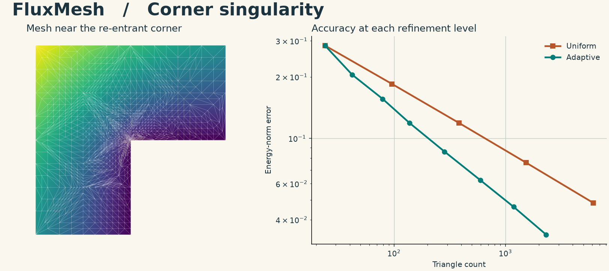

# FluxMesh FEM

An adaptive finite-element solver for scalar diffusion on triangular meshes. The demo asks a practical question: how many triangles do you need when the solution gradient becomes singular at one corner?



On the included L-shaped benchmark, seven adaptive steps used **2,314 triangles** and produced an energy-norm error of **0.03380**. Four uniform steps used **6,144 triangles** and produced **0.04830**. Both runs use the same initial mesh, linear elements, numerical integration rule and exact boundary data.

## Reproduce it

```sh
python3 -m venv .venv
. .venv/bin/activate
python -m pip install .
fluxmesh solve corner --steps 7 --out run
fluxmesh audit run
fluxmesh solve corner --mode uniform --steps 4 --out uniform-run
fluxmesh compare --out convergence.png
python -m unittest discover -s tests -v
```

Python 3.10+ is required. Each solve publishes a fresh directory with the final arrays in NPZ, a VTK field for ParaView, per-step CSV metrics and JSON run settings. The audit reconstructs the local affine field and weak residual from the arrays through a separate numerical path.

## The numerical problem

### Solve a custom plate

```sh
fluxmesh solve examples/laminated-plate.json --initial 4 --steps 5 --out plate-run
fluxmesh audit plate-run
```

The example places a localized heat source and sink on a two-material square plate. In the input JSON, `boundary: [a,b,c]` sets u = a + bx + cy on the perimeter. Each source has an amplitude, a center and a positive Gaussian width. Conductivities are positive constants between vertical breakpoints. Put each breakpoint on an initial grid line so that all descendant elements stay inside one material. The saved run contains the complete input configuration. You can move it and audit the exported field after removing the original input file. Custom runs report residuals and estimated error; analytic error columns are available for the manufactured benchmarks.

We solve −div(k grad u) = f with prescribed Dirichlet values on the whole boundary. For linear triangle basis functions the element stiffness is the triangle area times conductivity times the dot product of the two basis gradients. Dirichlet elimination retains a symmetric positive-definite system on the free degrees of freedom. Sparse assembly and the direct solve use SciPy. Mesh construction, local element operators, adaptivity, and verification are implemented here.

| Built-in case | Exact check |
| --- | --- |
| `smooth` | On the unit square, u = sin(πx) sin(πy). Uniform refinement approaches first-order energy convergence and second-order L² convergence. |
| `interface` | Conductivity jumps from 1 to 10 at x = 0.5. The exact solution has continuous normal flux and discontinuous gradient. An edge-aligned grid recovers it to roundoff. |
| `corner` | The bottom-right quadrant is removed from [−1,1]². The harmonic solution r^(2/3) sin(2θ/3) has an unbounded gradient at the 270-degree corner. |

## How the mesh adapts

Each triangle gets a residual indicator. The cell contribution is its diameter squared times the integrated squared source. Each interior edge contributes half its length squared times the squared jump in normal flux to each neighbor. Piecewise-constant conductivity and linear elements give zero flux divergence inside each cell. There is no Neumann-boundary residual in these benchmarks.

Dörfler marking selects the smallest descending set whose squared indicators cover a fraction `--theta` of the total. Each marked cell splits all three edges. Neighbors share midpoint IDs, and one-, two- and three-edge templates maintain conformity. The two-edge template chooses the shorter internal diagonal. Refinement checks the predicted cell count against `--max-cells` before allocating the next mesh. The last completed level is returned when the budget binds.

## Verification and scope

The suite checks isolated affine reproduction, transmission across a material interface, smooth convergence rates, random refinement against independent area, perimeter and Euler checks, and published-array tampering. The energy and L² errors are quadrature estimates against analytic fields. The singular integral is not evaluated exactly. A scalar residual indicator guides marking; its magnitude is not a certified bound with an explicit constant.

These cases assume straight-sided planar geometry, fixed scalar material coefficients per triangle, and full Dirichlet boundaries. The program reports the numerical residual and integrated source balance. It does not model transient, nonlinear or three-dimensional diffusion. Inspect `fluxmesh/cases.py` to add a manufactured solution and its forcing.
